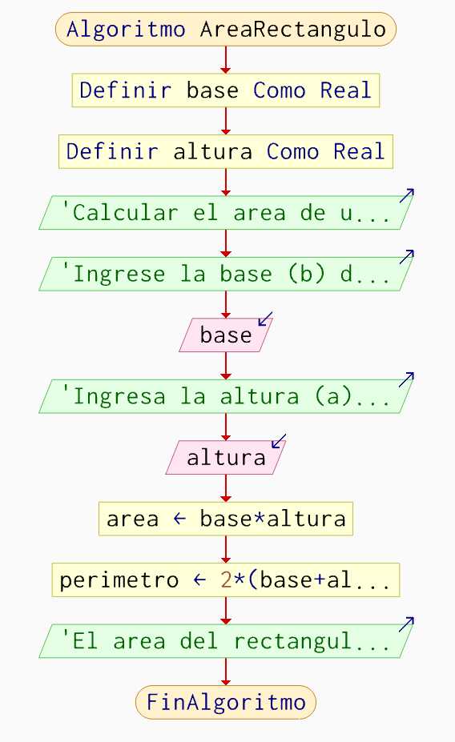

# Enunciado 

Área de un Rectángulo: Leer la base y la altura de un rectángulo, calcular y mostrar su área y su perímetro.

# Analisis

# Pseudocodigo

Algoritmo AreaRectangulo

	Definir base Como Real
	Definir altura Como Real
	
	Escribir  "Calcular el area de un rectangulo"
	Escribir "Ingrese la base (b) del rectangulo: "
	Leer base
	Escribir "Ingresa la altura (a) del rectangulo: "
	Leer altura
	
	area <- base * altura
	perimetro <- 2 *(base+altura)
	Escribir "El area del rectangulo es ", area " y el perimetro es ", perimetro

FinAlgoritmo

# Diagrama de flujo

[← Volver al README](../../README.md)