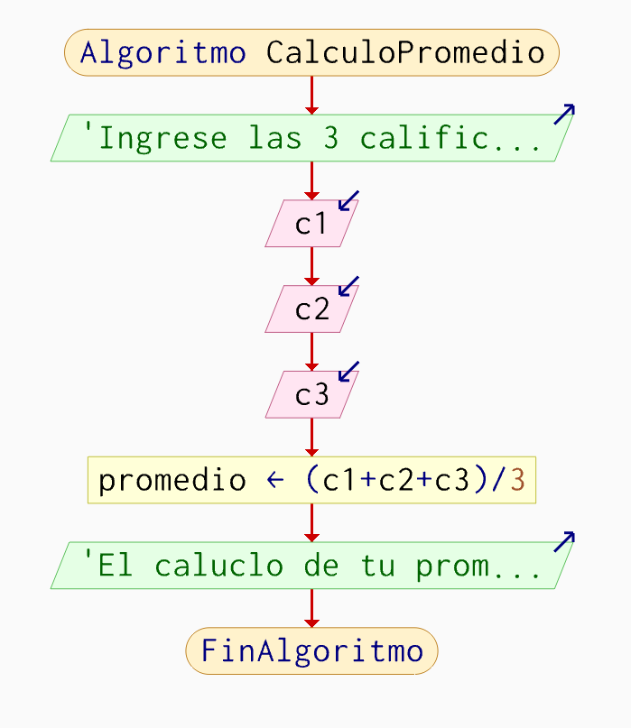

# Enunciado 

Cálculo de Promedio: Leer tres notas de un estudiante y calcular su promedio. Mostrar el resultado en pantalla.

# Analisis

# Pseudocodigo

Algoritmo CalculoPromedio

	Escribir "Ingrese las 3 calificaciones para calcular"
	Leer c1
	Leer c2
	Leer c3
	promedio=(c1+c2+c3)/3
	Escribir "El caluclo de tu promedio es: ", promedio

FinAlgoritmo

# Diagrama de flujo

[← Volver al README](../../README.md)