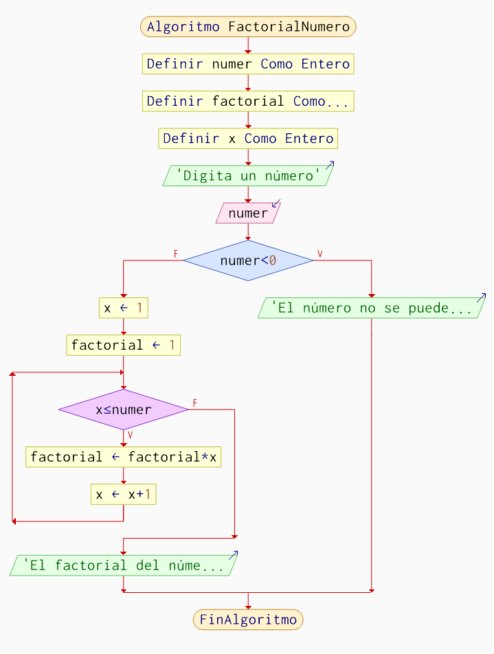

# Enunciado 

Factorial de un Número: Leer un número entero positivo y calcular su factorial (ej: 5! = 54321 = 120). Mostrar el resultado.

# Analisis

# Pseudocodigo

Algoritmo FactorialNumero

	Definir numer Como Entero
	Definir factorial Como Entero
	Definir x Como Entero
	
	Escribir "Digita un número"
	Leer numer
	
	Si numer <0 Entonces
		Escribir "El número no se puede calcular"
	SiNo
		x=1
		factorial=1
		Mientras x <= numer Hacer
			factorial = factorial*x
			x=x+1
		FinMientras
		Escribir "El factorial del número es = " factorial
	FinSi
	
FinAlgoritmo

# Diagrama de flujo

[← Volver al README](../../README.md)