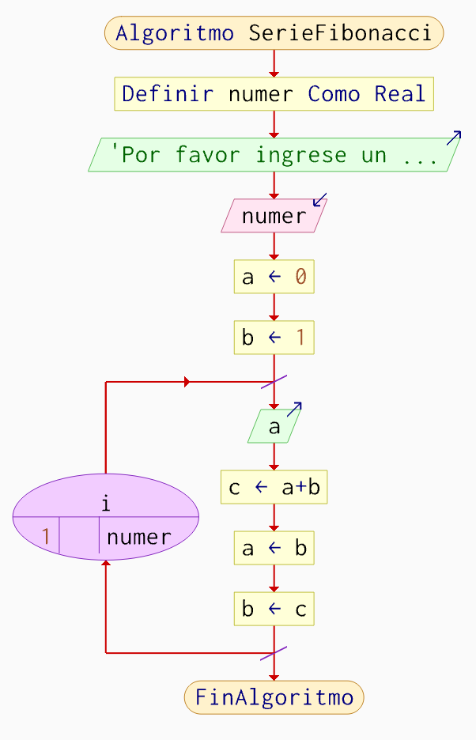

# Enunciado 

Serie de Fibonacci: Leer un número N y mostrar los primeros N términos de la serie de Fibonacci (0, 1, 1, 2, 3, 5, 8...).

# Analisis

# Pseudocodigo

Algoritmo SerieFibonacci

	Definir numer Como Real
	Escribir "Por favor ingrese un número "
	Leer numer
	
	a <- 0
	b <- 1
	Para  i<-1 Hasta numer Hacer
		Escribir a
		c <- a+b
		a <- b
		b <- c
		
	FinPara

FinAlgoritmo

# Diagrama de flujo

[← Volver al README](../../README.md)